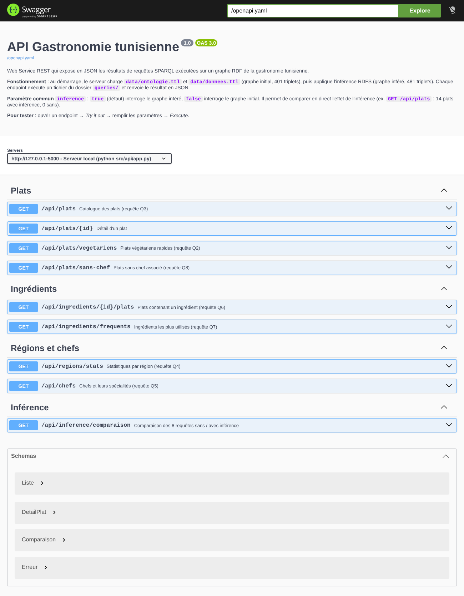

# Mini-projet Web Sémantique — Gastronomie tunisienne

Modélisation RDFS de la cuisine tunisienne, interrogation SPARQL, enrichissement par inférence RDFS et exposition des résultats en JSON par un Web Service REST documenté avec Swagger.

| Partie | Objectif | Où le trouver |
|---|---|---|
| 1. Modéliser | Vocabulaire RDFS + données RDF | `data/ontologie.ttl`, `data/donnees.ttl`, `docs/vocabulaire_rdfs.md`, `docs/schema_modele.png` |
| 2. Interroger | 8 requêtes SPARQL | `queries/q1..q8.rq`, `docs/resultats_sparql.md` |
| 3. Enrichir | Inférence RDFS, comparaison sans / avec | `src/inference.py`, `data/graphe_infere.ttl`, `docs/comparaison_inference.md` |
| 4. Exposer | Web Service REST, JSON, Swagger | `src/api/`, `tests/test_api.py` |

L'architecture complète (schéma, rôle de chaque fichier, fonctionnement de l'API, choix techniques) est décrite dans **`docs/architecture.md`**.

## Chiffres clés

- Vocabulaire : 14 classes, 9 propriétés, 11 `rdfs:subClassOf`, 2 `rdfs:subPropertyOf`, un `rdfs:domain` et un `rdfs:range` par propriété, vocabulaires externes FOAF, Dublin Core et DBpedia.
- Données : 14 plats, 35 ingrédients, 5 régions, 4 chefs (fictifs).
- Graphe initial : **401 triplets** → graphe inféré : **481 triplets** (+80 déduits, aucun perdu).

| Requête | Sans inférence | Avec inférence |
|---|---|---|
| Q1 — Plats principaux | 7 | 7 |
| Q2 — Végétariens ≤ 45 min | 4 | 4 |
| Q3 — Tous les plats (`gt:Plat`) | 0 | **14** |
| Q4 — Statistiques par région | 5 | 5 |
| Q5 — Chefs (`gt:Chef`) | 0 | **4** |
| Q6 — Plats contenant l'œuf | 3 | **4** |
| Q7 — Ingrédients fréquents | 7 | **12** |
| Q8 — Plats sans chef | 6 | 6 |

## Installation (une seule fois)

Prérequis : Python 3.10 ou plus récent.

Ouvrir un terminal **dans le dossier `projet-gastronomie-tn`** (sous VS Code : *Terminal → Nouveau terminal*).

```bash
python -m venv venv
```

Activer l'environnement virtuel :

```bash
venv\Scripts\activate          # Windows (cmd ou PowerShell)
source venv/bin/activate       # macOS / Linux
```

> Sous PowerShell, si l'activation est refusée : `Set-ExecutionPolicy -Scope CurrentUser RemoteSigned`, puis recommencer.

Installer les bibliothèques :

```bash
pip install -r requirements.txt
```

Le préfixe `(venv)` doit apparaître au début de la ligne du terminal. Toutes les commandes ci-dessous se lancent depuis le dossier `projet-gastronomie-tn`, environnement activé.

## Partie 1 — Vérifier la modélisation

```bash
python src/verifier_modele.py
```

Résultat attendu : `Partie 1 valide : schéma et données cohérents.`

## Partie 2 — Exécuter les requêtes SPARQL (sans inférence)

```bash
python src/executer_requetes.py
```

Affiche les résultats des 8 requêtes et régénère `docs/resultats_sparql.md` (question métier, notions SPARQL, code et résultats de chaque requête).

## Partie 3 — Inférence et comparaison

```bash
python src/inference.py
```

Applique les règles RDFS (rdfs2, rdfs3, rdfs7, rdfs9, rdfs11), régénère `data/graphe_infere.ttl` et `docs/comparaison_inference.md` (triplets déduits règle par règle, exemples avant / après, comparaison des 8 requêtes).

## Partie 4 — Web Service REST

### Lancer le serveur

```bash
python src/api/app.py
```

Attendre le message `Running on http://127.0.0.1:5000`. Laisser ce terminal ouvert (pour arrêter le serveur : `Ctrl + C`).

### Tester avec Swagger

1. Ouvrir **http://127.0.0.1:5000/docs** dans un navigateur.
2. Cliquer sur un endpoint, par exemple `GET /api/plats`.
3. Cliquer sur **Try it out**.
4. Remplir les paramètres (ex. `categorie = Dessert`, `inference = true`).
5. Cliquer sur **Execute** : Swagger affiche l'URL appelée, le code HTTP et la réponse JSON.

Démonstration de l'inférence en direct : exécuter `GET /api/chefs` avec `inference = false` (0 chef), puis avec `inference = true` (4 chefs).



### Liste des endpoints

| Endpoint | Requête | Exemple |
|---|---|---|
| `GET /api/plats` | Q3 | `/api/plats?categorie=Dessert` |
| `GET /api/plats/{id}` | détail | `/api/plats/Ojja` |
| `GET /api/plats/vegetariens` | Q2 | `/api/plats/vegetariens?max_temps=30` |
| `GET /api/plats/sans-chef` | Q8 | `/api/plats/sans-chef` |
| `GET /api/ingredients/{id}/plats` | Q6 | `/api/ingredients/Oeuf/plats` |
| `GET /api/ingredients/frequents` | Q7 | `/api/ingredients/frequents?min=5` |
| `GET /api/regions/stats` | Q4 | `/api/regions/stats` |
| `GET /api/chefs` | Q5 | `/api/chefs?inference=false` |
| `GET /api/inference/comparaison` | Q1 à Q8 | `/api/inference/comparaison` |

Paramètre commun : `inference=true` (défaut, graphe inféré) ou `inference=false` (graphe initial).

On peut aussi appeler les endpoints directement dans le navigateur (ex. `http://127.0.0.1:5000/api/plats/Ojja`) ou avec curl :

```bash
curl "http://127.0.0.1:5000/api/plats/vegetariens?max_temps=30"
```

### Tests automatiques

Dans un terminal (le serveur n'a pas besoin d'être lancé) :

```bash
python -m pytest -v
```

Résultat attendu : `33 passed`. Les tests vérifient les codes HTTP, le nombre de résultats avec et sans inférence, les erreurs, Swagger, que l'inférence ne perd aucun triplet et que `openapi.yaml` documente exactement les routes de l'application.

## Problèmes fréquents

| Message | Cause | Solution |
|---|---|---|
| `ModuleNotFoundError: No module named 'rdflib'` (ou `flask`, `owlrl`) | Environnement virtuel non activé | Activer `venv`, puis `pip install -r requirements.txt` |
| `FileNotFoundError` sur un fichier `.ttl` ou `.rq` | Fichier déplacé ou renommé | Garder l'arborescence du projet telle quelle |
| `Address already in use` / port 5000 occupé | Un serveur tourne déjà | Fermer l'autre terminal (`Ctrl + C`) ou changer `port=5000` dans `src/api/app.py` |
| Accents mal affichés dans le terminal Windows | Console non UTF-8 | Les scripts forcent l'UTF-8 ; sinon lancer `chcp 65001` avant |
| Swagger affiche « Failed to fetch » | Serveur arrêté | Relancer `python src/api/app.py` |
