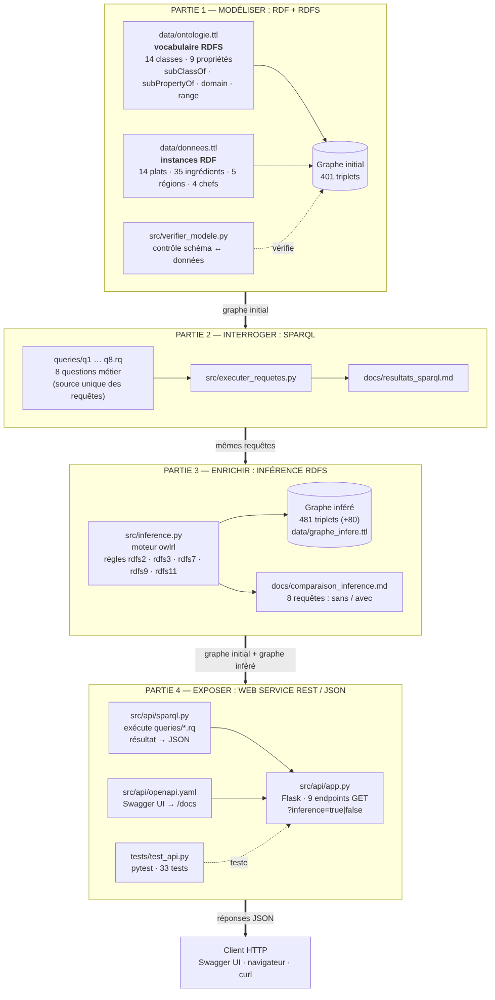

# Architecture du projet



*(Source du schéma : `architecture.mmd`, format Mermaid.)*

Le projet suit la chaîne **modéliser → interroger → enrichir → exposer**. Chaque partie a son propre emplacement et s'appuie sur la précédente.

## 1. Les quatre couches

| Couche | Rôle | Fichiers | Produit |
|---|---|---|---|
| **1. Modéliser** | Définir le vocabulaire (RDFS) et décrire les données (RDF) | `data/ontologie.ttl`, `data/donnees.ttl`, `src/verifier_modele.py` | Graphe initial : 401 triplets |
| **2. Interroger** | Répondre à 8 questions métier avec SPARQL | `queries/q1..q8.rq`, `src/executer_requetes.py` | `docs/resultats_sparql.md` |
| **3. Enrichir** | Appliquer les règles RDFS pour déduire de nouveaux triplets | `src/inference.py` | `data/graphe_infere.ttl` (481 triplets), `docs/comparaison_inference.md` |
| **4. Exposer** | Rendre les résultats accessibles en JSON par HTTP | `src/api/app.py`, `src/api/sparql.py`, `src/api/openapi.yaml` | 9 endpoints REST + Swagger UI |

`src/commun.py` contient les fonctions partagées par toutes les couches : chemins des dossiers, chargement du graphe, lecture et exécution des fichiers `.rq`.

## 2. Arborescence et rôle de chaque fichier

```
projet-gastronomie-tn/
├── README.md                     Présentation, installation, commandes
├── requirements.txt              Bibliothèques Python (versions exactes)
├── .gitignore                    Fichiers à ne pas livrer (venv, caches)
│
├── data/                         LES GRAPHES RDF
│   ├── ontologie.ttl             Partie 1 — vocabulaire RDFS (schéma)
│   ├── donnees.ttl               Partie 1 — instances (plats, ingrédients, régions, chefs)
│   └── graphe_infere.ttl         Partie 3 — résultat de l'inférence (produit par inference.py)
│
├── queries/                      TOUTES LES REQUÊTES SPARQL (source unique)
│   ├── q1_plats_principaux.rq    ┐
│   ├── ...                       │ Partie 2 — les 8 questions métier
│   ├── q8_plats_sans_chef.rq     ┘
│   └── api/                      Requêtes complémentaires pour GET /api/plats/{id}
│       ├── detail_plat.rq
│       ├── ingredients_plat.rq
│       └── chefs_plat.rq
│
├── src/                          LE CODE PYTHON
│   ├── commun.py                 Fonctions partagées
│   ├── verifier_modele.py        Partie 1 — vérifie le schéma et les données
│   ├── executer_requetes.py      Partie 2 — exécute les 8 requêtes sans inférence
│   ├── inference.py              Partie 3 — inférence RDFS et comparaison avant / après
│   └── api/                      Partie 4 — Web Service REST
│       ├── app.py                Serveur Flask : routes, validation, erreurs JSON
│       ├── sparql.py             Exécute un .rq et convertit le résultat en JSON
│       └── openapi.yaml          Documentation OpenAPI affichée par Swagger UI
│
├── tests/
│   └── test_api.py               33 tests automatiques (pytest)
│
└── docs/                         LA DOCUMENTATION
    ├── architecture.md / .png / .mmd   Ce document et son schéma
    ├── vocabulaire_rdfs.md       Description du vocabulaire (partie 1)
    ├── schema_modele.png / .svg / .dot Diagramme du modèle RDFS
    ├── resultats_sparql.md       Résultats des 8 requêtes (produit par executer_requetes.py)
    ├── comparaison_inference.md  Comparaison sans / avec inférence (produit par inference.py)
    └── swagger_apercu.png        Capture de l'interface Swagger
```

## 3. Fonctionnement du Web Service

### Au démarrage (`python src/api/app.py`)

1. Chargement de `ontologie.ttl` + `donnees.ttl` → **graphe initial** (401 triplets).
2. Chargement d'une seconde copie, puis inférence RDFS (`inference.graphe_infere()`) → **graphe inféré** (481 triplets).
3. Calcul, une seule fois, de la comparaison des 8 requêtes (pour `/api/inference/comparaison`).
4. Démarrage du serveur sur `http://127.0.0.1:5000`.

Les deux graphes restent **en mémoire** : chaque requête HTTP est rapide, l'inférence n'est jamais refaite.

### Pour chaque requête HTTP

Exemple : `GET /api/plats/vegetariens?max_temps=30&inference=false`

```
Client HTTP
   │  GET /api/plats/vegetariens?max_temps=30&inference=false
   ▼
app.py ── 1. valide les paramètres (max_temps entier entre 1 et 1000, inference true/false)
   │         → sinon réponse 400 en JSON
   │      2. choisit le graphe (inference=false → graphe initial)
   ▼
sparql.py ── 3. lit queries/q2_vegetariens_rapides.rq
   │         4. retire la ligne « VALUES ?max { 45 } » (valeur par défaut)
   │         5. exécute la requête avec rdflib en liant ?max = 30 (initBindings)
   │         6. convertit chaque ligne : URI → identifiant court, littéral → int / bool / str
   ▼
app.py ── 7. renvoie {"requete", "inference", "parametres", "nombre", "resultats"} en JSON
```

### Correspondance endpoints ↔ requêtes

| Endpoint | Fichier SPARQL | Paramètres |
|---|---|---|
| `GET /api/plats` | `q3_tous_les_plats.rq` | `categorie` (Plat, Entree, Soupe, PlatPrincipal, Dessert, Patisserie) |
| `GET /api/plats/{id}` | `api/detail_plat.rq`, `api/ingredients_plat.rq`, `api/chefs_plat.rq` | `id` (ex. Ojja) |
| `GET /api/plats/vegetariens` | `q2_vegetariens_rapides.rq` | `max_temps` (défaut 45) |
| `GET /api/plats/sans-chef` | `q8_plats_sans_chef.rq` | — |
| `GET /api/ingredients/{id}/plats` | `q6_plats_par_ingredient.rq` | `id` (ex. Oeuf) |
| `GET /api/ingredients/frequents` | `q7_ingredients_frequents.rq` | `min` (défaut 3) |
| `GET /api/regions/stats` | `q4_stats_par_region.rq` | — |
| `GET /api/chefs` | `q5_chefs_specialites.rq` | — |
| `GET /api/inference/comparaison` | les 8 requêtes `q1..q8` | — |

Tous les endpoints acceptent aussi `inference=true` (défaut) ou `inference=false`. La requête Q1 (plats principaux) correspond à `GET /api/plats?categorie=PlatPrincipal`.

### Codes HTTP

| Code | Cas | Exemple |
|---|---|---|
| 200 | Succès | `GET /api/plats` |
| 400 | Paramètre invalide | `?max_temps=abc`, `?categorie=Pizza`, `?inference=oui` |
| 404 | Ressource ou route inconnue | `/api/plats/Inexistant`, `/api/ingredients/Sfax/plats` |
| 405 | Méthode autre que GET | `POST /api/plats` |
| 500 | Erreur interne | — |

Toutes les erreurs sont renvoyées en JSON : `{"erreur": {"code": 400, "message": "..."}}`.

## 4. Choix techniques et justification

| Choix | Pourquoi |
|---|---|
| **rdflib** | Bibliothèque Python de référence pour lire du Turtle et exécuter du SPARQL, sans serveur externe à installer. |
| **owlrl** (sémantique RDFS) | Implémente les règles de la norme RDFS du W3C ; on n'écrit pas les règles à la main. |
| **Flask** | Framework web minimal : une fonction Python = un endpoint. Facile à lire et à expliquer. |
| **Swagger UI + OpenAPI** | Documentation standard des API REST, avec test interactif dans le navigateur. Le paquet `flask-swagger-ui` contient l'interface : elle fonctionne sans connexion internet. |
| **Requêtes dans des fichiers `.rq`** | Une seule version de chaque requête, utilisée à la fois par les scripts et par l'API : pas de différence possible entre les résultats du rapport et ceux du Web Service. |
| **Paramètres liés par `initBindings`** | La valeur envoyée par l'utilisateur n'est jamais collée dans le texte SPARQL : pas d'injection SPARQL possible. Les identifiants sont aussi limités aux lettres et chiffres. |
| **Graphes en mémoire** | Le jeu de données est petit (moins de 500 triplets) : pas besoin d'un triplestore comme Fuseki. |
| **Deux graphes (initial et inféré)** | Permet de montrer l'effet de l'inférence en direct, avec le paramètre `inference`. |
| **Inférence sans perte** | Le nettoyage du « bruit » ne retire que des triplets déduits ; le test `test_inference_ne_perd_aucun_triplet` le vérifie. |
