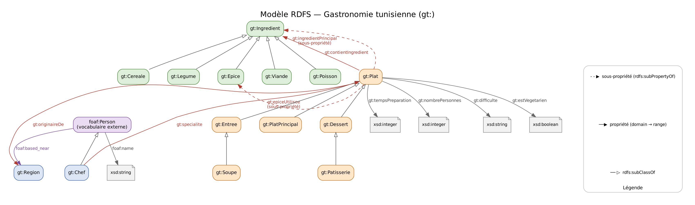

# Partie 1 — Description du vocabulaire RDFS

Ce document décrit le vocabulaire défini dans `data/ontologie.ttl` et la façon dont il est utilisé dans `data/donnees.ttl`.



## 1. Pourquoi deux fichiers séparés ?

| Fichier | Contenu | Rôle |
|---|---|---|
| `data/ontologie.ttl` | 88 triplets : classes, propriétés, hiérarchies, domain, range | **Le schéma** : décrit *quels types de choses* existent et *comment ils peuvent être reliés*. |
| `data/donnees.ttl` | 313 triplets : plats, ingrédients, régions, chefs | **Les instances** : décrit *les choses concrètes* (le Couscous au poisson, la Harissa, Sfax...). |

Séparer le schéma des données est une bonne pratique du Web sémantique : on peut modifier ou agrandir les données sans toucher au vocabulaire, et réutiliser le vocabulaire avec d'autres données. Les deux fichiers sont chargés ensemble dans un seul graphe (401 triplets) par `src/commun.py`.

## 2. Espaces de noms (préfixes)

| Préfixe | URI | Origine | Utilisation |
|---|---|---|---|
| `gt:` | `http://example.org/gastronomie-tn/ontologie#` | **Notre vocabulaire** | Classes et propriétés du projet |
| `res:` | `http://example.org/gastronomie-tn/ressource/` | **Nos ressources** | Plats, ingrédients, régions, chefs |
| `rdf:` | `http://www.w3.org/1999/02/22-rdf-syntax-ns#` | W3C | `rdf:type`, `rdf:Property` |
| `rdfs:` | `http://www.w3.org/2000/01/rdf-schema#` | W3C | `rdfs:Class`, `rdfs:subClassOf`, `rdfs:subPropertyOf`, `rdfs:domain`, `rdfs:range`, `rdfs:label`, `rdfs:comment`, `rdfs:seeAlso` |
| `xsd:` | `http://www.w3.org/2001/XMLSchema#` | W3C | Types de valeurs : `xsd:integer`, `xsd:string`, `xsd:boolean` |
| `foaf:` | `http://xmlns.com/foaf/0.1/` | FOAF (externe) | Personnes : `foaf:Person`, `foaf:name`, `foaf:based_near` |
| `dcterms:` | `http://purl.org/dc/terms/` | Dublin Core (externe) | `dcterms:description` |
| `dbr:` | `http://dbpedia.org/resource/` | DBpedia (externe) | Liens vers des ressources du Web de données |

Les URI en `example.org` sont réservées aux exemples : elles sont adaptées à un projet universitaire qui n'est pas publié sur le Web.

## 3. Les classes (14 classes `gt:` + 1 classe externe)

| Classe | Sous-classe de | Signification | Instances déclarées | Instances après inférence |
|---|---|---|---|---|
| `gt:Plat` | — | Un plat de la cuisine tunisienne | 0 | 14 |
| `gt:Entree` | `gt:Plat` | Entrée | 2 | 4 |
| `gt:Soupe` | `gt:Entree` | Soupe (une sorte d'entrée) | 2 | 2 |
| `gt:PlatPrincipal` | `gt:Plat` | Plat principal | 7 | 7 |
| `gt:Dessert` | `gt:Plat` | Dessert | 1 | 3 |
| `gt:Patisserie` | `gt:Dessert` | Pâtisserie (une sorte de dessert) | 2 | 2 |
| `gt:Ingredient` | — | Produit utilisé dans un plat | 13 | 35 |
| `gt:Cereale` | `gt:Ingredient` | Céréale (semoule, frik, riz, farine) | 4 | 4 |
| `gt:Legume` | `gt:Ingredient` | Légume | 9 | 9 |
| `gt:Epice` | `gt:Ingredient` | Épice ou condiment | 0 | 4 |
| `gt:Viande` | `gt:Ingredient` | Viande | 3 | 3 |
| `gt:Poisson` | `gt:Ingredient` | Poisson | 2 | 2 |
| `gt:Chef` | `foaf:Person` | Chef cuisinier | 0 | 4 |
| `gt:Region` | — | Région (gouvernorat) d'origine d'un plat | 5 | 5 |
| `foaf:Person` *(externe)* | — | Personne, au sens du vocabulaire FOAF | 4 | 4 |

### Hiérarchies (`rdfs:subClassOf`)

```
gt:Plat                         gt:Ingredient                 foaf:Person  (FOAF)
 ├── gt:Entree                   ├── gt:Cereale                 └── gt:Chef
 │    └── gt:Soupe               ├── gt:Legume
 ├── gt:PlatPrincipal            ├── gt:Epice
 └── gt:Dessert                  ├── gt:Viande
      └── gt:Patisserie          └── gt:Poisson
```

La hiérarchie des plats a **deux niveaux** (Soupe → Entrée → Plat, Pâtisserie → Dessert → Plat) : c'est ce qui permet de montrer la **transitivité** de `rdfs:subClassOf` lors de l'inférence (partie 3).

## 4. Les propriétés (9 propriétés `gt:`)

### Propriétés d'objet : relient deux ressources

| Propriété | `rdfs:domain` | `rdfs:range` | Sous-propriété de | Signification | Exemple |
|---|---|---|---|---|---|
| `gt:contientIngredient` | `gt:Plat` | `gt:Ingredient` | — | Le plat contient cet ingrédient | `res:Ojja gt:contientIngredient res:Tomate` |
| `gt:ingredientPrincipal` | `gt:Plat` | `gt:Ingredient` | `gt:contientIngredient` | Ingrédient principal du plat | `res:Ojja gt:ingredientPrincipal res:Oeuf` |
| `gt:epiceUtilisee` | `gt:Plat` | `gt:Epice` | `gt:contientIngredient` | Épice utilisée dans le plat | `res:Ojja gt:epiceUtilisee res:Harissa` |
| `gt:originaireDe` | `gt:Plat` | `gt:Region` | — | Région d'origine du plat | `res:CouscousPoisson gt:originaireDe res:Sfax` |
| `gt:specialite` | `gt:Chef` | `gt:Plat` | — | Plat dont le chef est spécialiste | `res:HediJaziri gt:specialite res:Brik` |

### Propriétés de données : relient une ressource à une valeur

| Propriété | `rdfs:domain` | `rdfs:range` | Signification | Exemple |
|---|---|---|---|---|
| `gt:tempsPreparation` | `gt:Plat` | `xsd:integer` | Temps de préparation en minutes | `res:Ojja gt:tempsPreparation 30` |
| `gt:nombrePersonnes` | `gt:Plat` | `xsd:integer` | Nombre de portions | `res:Ojja gt:nombrePersonnes 4` |
| `gt:difficulte` | `gt:Plat` | `xsd:string` | Facile, Moyenne ou Difficile | `res:Ojja gt:difficulte "Facile"` |
| `gt:estVegetarien` | `gt:Plat` | `xsd:boolean` | Le plat est-il végétarien ? | `res:Ojja gt:estVegetarien false` |

### Hiérarchie des propriétés (`rdfs:subPropertyOf`)

```
gt:contientIngredient
 ├── gt:ingredientPrincipal
 └── gt:epiceUtilisee
```

Signification : l'ingrédient principal et les épices d'un plat sont **aussi** des ingrédients contenus dans ce plat. Dans les données, ils ne sont écrits qu'une seule fois (avec la sous-propriété) ; l'inférence ajoute automatiquement le triplet `gt:contientIngredient` correspondant.

### À quoi servent `rdfs:domain` et `rdfs:range` ?

Ils ne sont pas des contraintes de validation : en RDFS, ce sont des **règles de déduction**.

- `gt:specialite rdfs:domain gt:Chef` : toute ressource qui a une spécialité **est** un chef. Les chefs sont déclarés seulement comme `foaf:Person` dans les données : le type `gt:Chef` est déduit (règle rdfs2).
- `gt:epiceUtilisee rdfs:range gt:Epice` : toute ressource utilisée comme épice **est** une épice. Les épices n'ont aucun type dans les données : le type `gt:Epice` est déduit (règle rdfs3), puis `gt:Ingredient` (règle rdfs9).

## 5. Vocabulaires externes réutilisés

Réutiliser des vocabulaires connus permet à d'autres applications de comprendre nos données sans connaître notre vocabulaire `gt:`.

| Vocabulaire | Élément | Utilisation dans le projet | Pourquoi ce choix |
|---|---|---|---|
| **FOAF** (*Friend of a Friend*) | `foaf:Person` | Super-classe de `gt:Chef` | Vocabulaire standard pour décrire des personnes |
| | `foaf:name` | Nom des chefs | Propriété standard du nom d'une personne |
| | `foaf:based_near` | Ville du chef (une `gt:Region`) | Propriété standard de localisation d'une personne |
| **Dublin Core** (`dcterms`) | `dcterms:description` | Description textuelle des plats | Standard des métadonnées descriptives |
| **RDFS** | `rdfs:label` | Noms en français (`@fr`) et en arabe (`@ar`) | Étiquette lisible, multilingue grâce aux balises de langue |
| | `rdfs:comment` | Commentaires sur le vocabulaire | Documentation des classes et propriétés |
| | `rdfs:seeAlso` | Lien vers DBpedia (5 plats) | Relier nos données au Web de données ouvert |
| **XSD** | `xsd:integer`, `xsd:string`, `xsd:boolean` | Types des valeurs littérales | Types de données standards |
| **DBpedia** | `dbr:Couscous`, `dbr:Brik`, `dbr:Lablabi`, `dbr:Shakshouka` | Cible des `rdfs:seeAlso` | Version RDF de Wikipédia, référence du Linked Data |

Les éléments FOAF et Dublin Core sont déclarés dans `ontologie.ttl` avec seulement un `rdfs:label` : on ne redéfinit **pas** leur domaine ni leur co-domaine, car ce vocabulaire ne nous appartient pas.

## 6. Choix de modélisation faits pour l'inférence

Certaines informations ne sont volontairement **pas** écrites dans les données, car le schéma permet de les déduire. Cela rend visible l'apport de l'inférence (partie 3) :

| Information absente des données | Règle qui la déduit | Requête qui en dépend |
|---|---|---|
| Aucun plat n'est typé `gt:Plat` (seulement sa catégorie la plus précise) | rdfs9 + rdfs11 (`subClassOf`) | Q3 : 0 → 14 |
| Les chefs sont seulement des `foaf:Person` | rdfs2 (`domain` de `gt:specialite`) | Q5 : 0 → 4 |
| L'ingrédient principal et les épices ne sont pas répétés avec `gt:contientIngredient` | rdfs7 (`subPropertyOf`) | Q6 : 3 → 4, Q7 : 7 → 12 |
| Les épices n'ont pas de `rdf:type` | rdfs3 (`range` de `gt:epiceUtilisee`) puis rdfs9 | Q7, `/api/ingredients/Harissa/plats` |

## 7. Constitution du jeu de données

| Élément | Nombre | Provenance |
|---|---|---|
| Plats | 14 | Plats traditionnels tunisiens réels (couscous, brik, lablabi, makroudh...). Temps, portions et difficulté sont des **valeurs indicatives** choisies par le binôme. |
| Ingrédients | 35 | Ingrédients usuels de ces recettes : 4 céréales, 9 légumes, 3 viandes, 2 poissons, 4 épices, 13 autres. |
| Régions | 5 | Gouvernorats réels : Tunis, Sfax, Nabeul, Médenine (Djerba), Kairouan. |
| Chefs | 4 | **Personnes fictives**, créées pour illustrer FOAF et la règle du domaine. |
| Liens DBpedia | 5 | Ressources DBpedia existantes (`rdfs:seeAlso`). |

Le jeu de données est volontairement de petite taille : il suffit à illustrer chaque notion (hiérarchies, sous-propriétés, domain/range, agrégats SPARQL, négation) tout en restant vérifiable à la main pendant la soutenance.

## 8. Vérification automatique

```
python src/verifier_modele.py
```

Le script vérifie : au moins 5 classes et 8 propriétés, présence de `rdfs:subClassOf` et `rdfs:subPropertyOf`, un `rdfs:domain` et un `rdfs:range` pour chaque propriété `gt:`, la réutilisation de FOAF, que toutes les classes et propriétés utilisées dans les données sont déclarées, qu'aucune URI ne contient de faute de frappe, et que les valeurs respectent leur type (`xsd:integer`, `xsd:string`, `xsd:boolean`).
